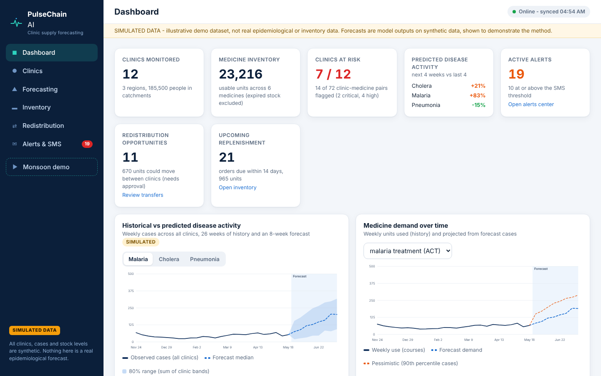
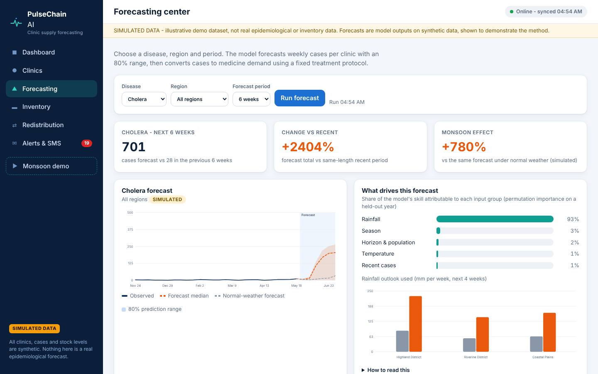
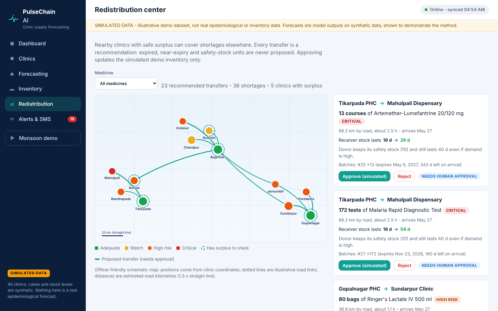
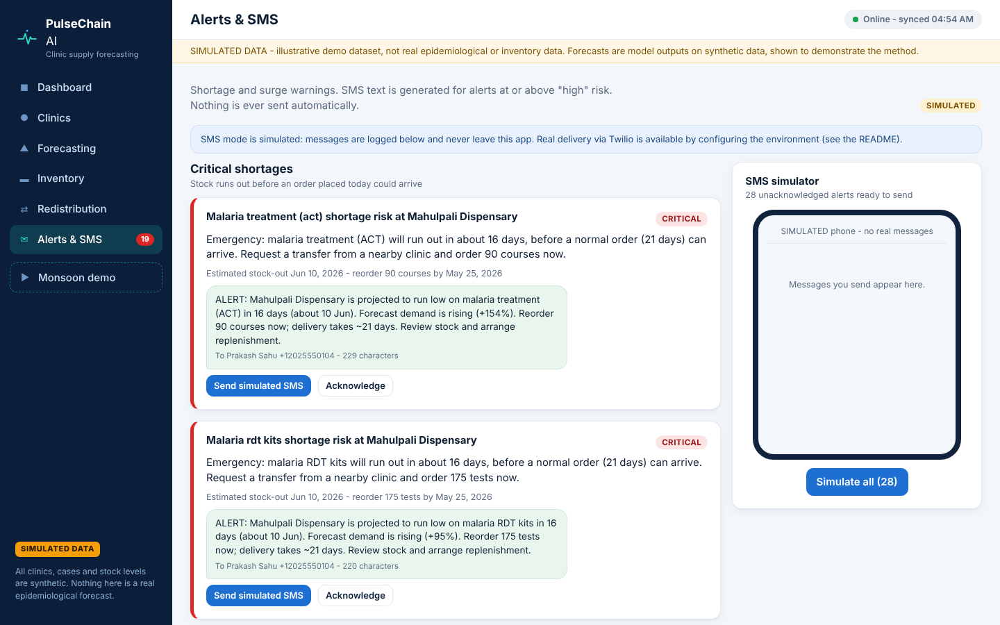
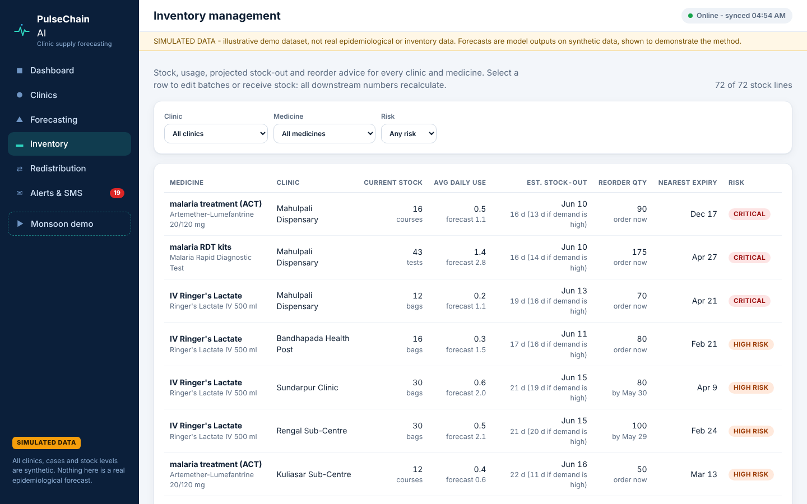
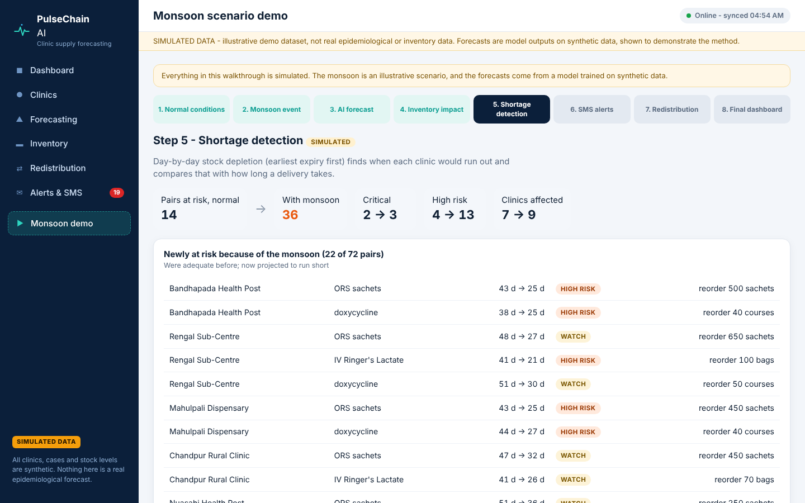
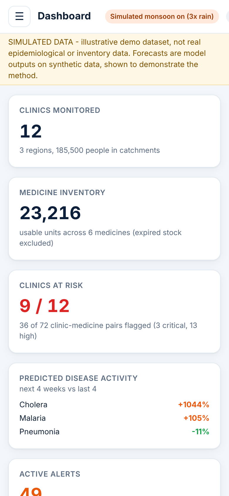

# PulseChain AI

**Forecast the disease surge. Protect the medicine supply. Before the rains arrive.**

PulseChain AI is an offline-friendly web app that helps rural clinics see medicine shortages *before* a seasonal outbreak hits. It forecasts disease activity from rainfall, season and recent cases, converts the forecast into medicine demand, finds clinics that will run out, warns health workers by SMS, and recommends safe transfers between nearby clinics.

> **Everything in this repository runs on SIMULATED data.** The clinics, cases, weather and stock levels are synthetic, and the monsoon "spike" is an illustrative scenario, not an epidemiological prediction. The app labels this on every screen. See [Using real data](#using-real-data).



## Contents
[Problem](#problem) - [Solution](#solution) - [Features](#features) - [Quick start](#quick-start) - [Demo](#the-monsoon-demo) - [Architecture](#architecture) - [ML methodology](#ml-methodology) - [Inventory rules](#inventory-rules) - [Redistribution rules](#redistribution-rules) - [SMS](#sms-alerts) - [Offline](#offline-behaviour) - [Dataset](#dataset) - [API](#api) - [Tests](#tests) - [Screenshots](#screenshots) - [Limitations](#limitations) - [Future work](#future-improvements)

## Problem
Remote clinics face demand that swings with the seasons. Malaria and cholera surge after heavy rain, but a clinic with a three-week delivery time and no forecasting finds out when the shelf is already empty.

## Solution
1. **Forecast** weekly cases per clinic for the next 8 weeks, with an 80% range.
2. **Translate** cases into medicine demand with a transparent treatment protocol.
3. **Detect** which clinic/medicine pairs run out before a delivery could arrive.
4. **Warn** health workers by short SMS; **recommend** transfers from clinics with safe surplus.
5. **Keep people in control**: transfers and alerts are recommendations; nothing is sent or moved automatically.

## Features
| Area | What it does |
|---|---|
| Disease forecasting | Gradient-boosted models for malaria, cholera and pneumonia; prediction bands; beats seasonal-naive and persistence baselines on a held-out year; factor importance |
| Inventory engine | Day-by-day FEFO depletion, stock-out date, reorder quantity and date, risk class; expired stock excluded |
| SMS alerts | Configurable threshold; <= 320-character messages; **simulated mode by default**; optional Twilio delivery behind four safeguards |
| Redistribution | Donor/receiver matching with safety stock, expiry, distance and timing rules; interactive map; human approval |
| Dashboard | KPIs, forecast vs history, demand, inventory cover, risk distribution, regional activity |
| Pages | Dashboard, Clinics (+detail), Forecasting center, Inventory (editable), Redistribution, Alerts & SMS, Monsoon demo |
| Offline PWA | Installable; app shell cached; last-synced data viewable offline; edits queued and replayed on reconnect; visible online/offline indicator |

## Quick start
Requirements: Python 3.10+. (Node is **not** needed: the frontend is plain ES modules, no build step.)

```bash
pip install -r requirements.txt
cd backend
python -m pulsechain.cli serve        # first run generates the data and trains the model (~30 s)
# open http://127.0.0.1:8000
```

Or via npm scripts: `npm run setup && npm start`.

| Command | Purpose |
|---|---|
| `python -m pulsechain.cli reset --train` | regenerate the synthetic dataset and retrain |
| `python -m pulsechain.cli train` | retrain only; prints validation vs baselines |
| `python -m pulsechain.cli serve` | run the app |
| `python scripts/e2e_check.py` | walk the whole demo through the API and verify every claim |
| `cd backend && python -m pytest -q` | unit and API tests (`python -m unittest discover -s tests -t .` also works) |

Copy `.env.example` to `.env` to change ports, the alert threshold, SMS or weather settings. **No secrets are committed**; `.env` is git-ignored.

## The monsoon demo
Open **Monsoon demo** in the sidebar. It follows the eight steps below, all driven by real calculations from the API:

1. **Normal conditions**: stable activity, mostly adequate stock (a few lean remote clinics are already watched).
2. **Simulated monsoon**: press *Trigger simulated monsoon* to inject heavy rain into the weather outlook (3x normal, ramping over 2 weeks).
3. **AI forecast**: the model projects higher malaria and a sharp cholera rise, with ranges.
4. **Inventory impact**: forecast cases become higher daily demand for ACT, RDT kits, ORS, Ringer's lactate and others.
5. **Shortage detection**: pairs at risk jump (about 14 to 36 in the default dataset).
6. **SMS alerts**: warnings are generated and sent to a *simulated* phone.
7. **Redistribution**: safe transfers appear on the map; approve them (simulated).
8. **Final dashboard**: before / during / after comparison. *Reset demo* restores the data.

Run `python scripts/e2e_check.py` to verify the same flow headlessly.

## Architecture
```
frontend/ (PWA, ES modules, SVG charts + map, service worker)
   |  fetch /api/*  (GET cached in localStorage; offline edits queued)
backend/pulsechain/
   api.py          Flask routes, validation, JSON errors, static hosting
   engine.py       orchestration + caching; applies edits, approvals, scenario
   forecast.py     features, training, validation, inference, weather scenario
   inventory.py    demand conversion, FEFO simulation, risk, reorder
   redistribution.py   transfer matching
   alerts.py / sms.py  alert text, threshold, simulated/live delivery
   weather.py      optional Open-Meteo (informational only)
   data_gen.py / db.py / domain.py / config.py   synthetic data, SQLite, constants, settings
data/              SQLite database + trained models (git-ignored, regenerated)
scripts/e2e_check.py   scripted demonstration check
```
**Stack choices:** Flask + SQLite + scikit-learn + a dependency-free JS frontend. This was chosen over React/TypeScript/FastAPI/Leaflet for *reliability offline and zero build steps*: the map is a schematic SVG (no tile server needed), charts are hand-written SVG, and the app runs with `pip install` alone. `HistGradientBoostingRegressor` replaces XGBoost to avoid an extra dependency; it can be swapped in `forecast.py`. SQLite is used for the demo, with plain SQL kept simple so PostgreSQL can be adopted later.

## ML methodology
* **Pooled models:** one model family per disease trained on every (clinic, origin week, horizon 1-8) row, about 24,000 rows per disease.
* **Target:** log(1 + cases per 1,000 catchment population).
* **Features:** recent case rates, rainfall 1-2 / 2-5 / 8 weeks before the target week, recent temperature, season (sin/cos), horizon, population.
* **Uncertainty:** mean model plus 10th/90th percentile quantile models. Raw bands under-covered, so they are widened by one factor calibrated on the first half of the held-out year and **coverage is reported on the second half**.
* **Weather at forecast time:** future weeks use a climatology outlook, or a scenario (the monsoon). Training uses observed weather, so real accuracy would also depend on weather-forecast quality.
* **Validation:** temporal split, final 52 weeks held out; compared with *seasonal naive* and *persistence*.

Held-out results on the synthetic data (mean absolute error, cases per clinic-week):

| Disease | Model | Seasonal naive | Persistence | 80% band coverage |
|---|---|---|---|---|
| Malaria | 3.46 | 4.18 | 5.65 | 81% |
| Cholera | 1.46 | 2.65 | 3.25 | 87% |
| Pneumonia | 4.63 | 5.12 | 6.02 | 77% |

These numbers describe the method on simulated data only. The generator was built with a lagged rainfall effect, so the model finding rainfall important is expected; it is **not** evidence about real outbreaks.

## Inventory rules
Plain, auditable rules; no model output is used directly as a stock figure.
1. Weekly demand = routine baseline use + forecast cases x units per case (a simplified protocol in `domain.py`, **not clinical guidance**).
2. Stock is depleted daily, earliest expiry first. Expired batches are excluded; units that expire unused are counted as waste.
3. `margin = days until stock-out - supplier delivery time`. **Critical** < 0, **High** < 10 days, **Watch** < 21 days, otherwise **Adequate**.
4. Reorder quantity = demand over (delivery time + 28 days) + safety stock - usable stock, rounded up to the pack size. Order-by date = day stock hits safety level minus delivery time.
5. A pessimistic case uses the 90th-percentile forecast.

## Redistribution rules
* **Receivers:** Watch or worse, needing a reorder. **Donors:** Adequate clinics only, and only stock above their own pessimistic demand over (delivery time + 28 days) plus safety stock.
* Expired batches never move; a batch needs at least 90 days of shelf life on arrival and the receiver must be able to use it before it expires.
* Same medicine only; road distance (1.3 x straight line) at most 140 km and 6 hours; the delivery must arrive before the receiver runs out.
* Most urgent receiver first, nearest feasible donor first. **Every transfer needs human approval**; approving updates the *simulated* inventory only.

## SMS alerts
Example (real output from the simulated monsoon): `ALERT: Mahulpali Dispensary is projected to run low on malaria treatment (ACT) in 16 days (about 10 Jun). Forecast demand is rising (+154%). Reorder 90 courses now; delivery takes ~21 days. Review stock and arrange replenishment.`

* Default `SMS_MODE=simulated`: messages are logged and shown on a simulated phone; nothing leaves the app.
* Live delivery through Twilio requires **all** of: `SMS_MODE=live`, `SMS_ALLOW_LIVE=true`, Twilio credentials, and `confirm_live: true` on each request. Otherwise the attempt is *blocked and logged*. Tests assert that the network is never touched without these.
* Clinic phone numbers in the dataset are reserved fictional numbers (`+1202555xxxx`). Replace them before any live use.

## Offline behaviour
What works offline: opening the installed app, viewing dashboards and pages that were synced earlier (with the last-sync time shown), and editing inventory or acknowledging alerts (queued, then replayed when the connection returns; conflicts are reported).
What does **not** work offline, and the app says so: running a *new* forecast, triggering the scenario, sending SMS, approving transfers' server-side recalculation. Projections after an offline edit update only after syncing.

## Dataset
Generated by `backend/pulsechain/data_gen.py` (seeded, deterministic, resettable): 12 clinics in three regions (highland, riverine, coastal), 5 years of weekly data for 3 diseases (malaria, cholera, pneumonia), 6 medicines, weekly weather, consumption derived from cases, and 148 inventory batches with expiry dates (including some already expired and some near expiry). Rainfall relationships are lagged and noisy; rainfall alone does not determine outbreaks.

## Using real data
Replace the generator output with real tables of the same shape (`clinics`, `weather`, `cases`, `consumption`, `inventory_batches`; see `db.py`), retrain with `python -m pulsechain.cli train`, review the validation output, and have epidemiologists validate before any operational use. Treatment protocols in `domain.py` must be replaced with locally approved guidance.

## API
JSON over REST; errors look like `{"error": "..."}`. Main routes:

| Route | Purpose |
|---|---|
| `GET /api/health`, `/api/meta`, `/api/model` | status, settings, model metrics and importance |
| `GET /api/summary`, `/api/clinics`, `/api/clinics/<id>` | dashboard, clinic list and detail |
| `GET /api/forecast?disease=&region=&weeks=` | forecast, demand projection, drivers, validation |
| `GET/POST /api/scenario` | read or change the simulated monsoon |
| `GET /api/inventory`, `PATCH /api/inventory/batches/<id>`, `POST /api/inventory/batches` | stock lines; edit quantity; receive stock |
| `GET /api/transfers`, `POST /api/transfers/decision` | recommendations; approve or reject |
| `GET /api/alerts`, `POST /api/alerts/ack`, `POST /api/sms/send`, `GET /api/sms/log` | alerts and SMS |
| `GET /api/demo/walkthrough` | data for the 8-step demo |
| `GET /api/weather/live?clinic_id=` | optional live Open-Meteo outlook (informational) |
| `POST /api/admin/reset` | reset the demo data |

## Tests
`backend/tests` covers: stock-depletion arithmetic, expiry handling, risk boundaries, reorder maths; every redistribution safety rule; alert text and thresholds; the SMS safeguards (network mocked); data determinism; model beats baselines and monsoon response; and every API route plus validation and the inventory-edit and transfer-approval workflows. `scripts/e2e_check.py` verifies the whole demo.

## Screenshots
| | |
|---|---|
|  Forecasting center (monsoon scenario) |  Redistribution map |
|  Alerts and simulated SMS |  Inventory |
|  Monsoon demo |  Mobile |

## Limitations
* Synthetic data only; no clinical or epidemiological validation.
* Intervals are calibrated on one held-out year of simulated data; pneumonia coverage (77%) is a little below the 80% target.
* The treatment protocol is simplified and not clinical guidance.
* Live weather is shown for information and not mixed into the frozen-date demo forecasts.
* The schematic map has no street tiles; distances are estimates.
* Flask's development server is used; deploy behind a production WSGI server for anything real.
* No authentication: add it before real deployment.

## Future improvements
Real surveillance and weather ingestion; PostgreSQL; XGBoost/Prophet comparison; per-clinic calibration; USSD/SMS two-way replies; user accounts and roles; multi-language SMS; supplier lead-time learning.

## License
MIT
